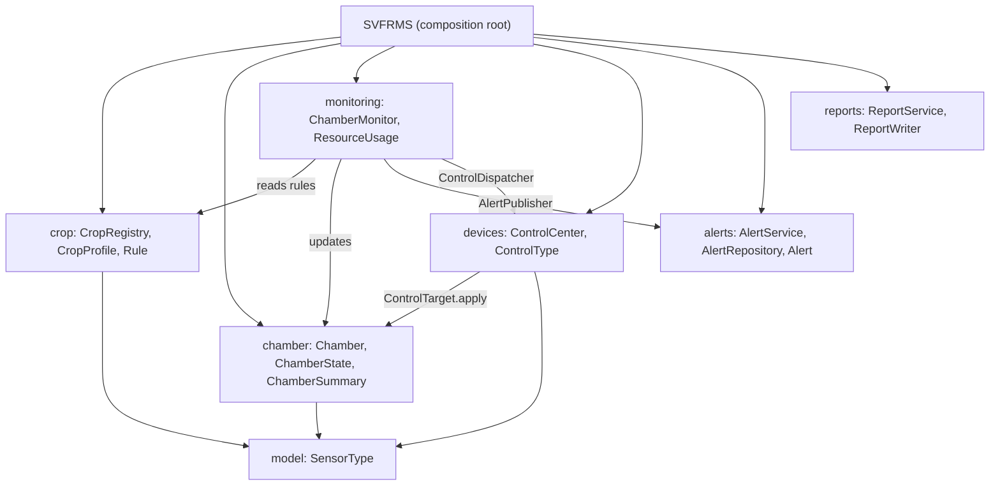
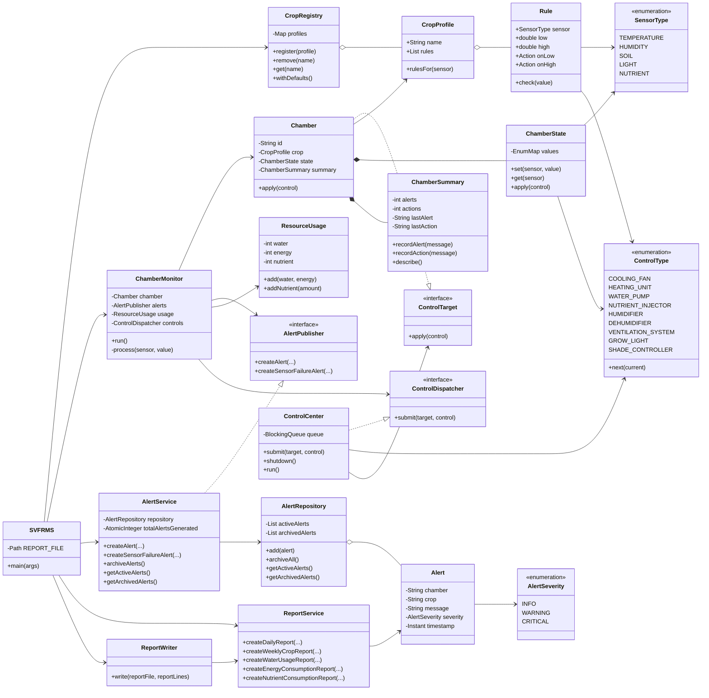
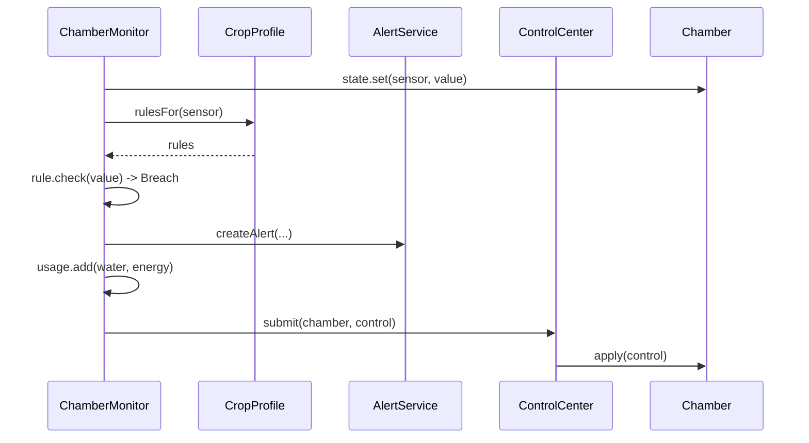

# SE301_Project
# SVFRMS Technical Report

**SE301 Advanced Programming and Design, Project 2026-27**
**Group number:** 9 **Team members:** Shubhangi, Jeniffer, Yasmin
<div style="page-break-after: always;"></div>

## 1. Legacy System Analysis

The Singapore Vertical Farming Research Management System (SVFRMS) simulates a facility of growing chambers. Each chamber holds one crop. Sensors report temperature, humidity, soil moisture, light and nutrient level. When a reading leaves the crop's acceptable range, the system raises an alert, triggers an automated device (cooling fan, water pump, humidifier, dehumidifier, grow light, nutrient injector), and records resource use. At the end it archives alerts and writes a daily report.

The legacy code was a single 394-line class, `SVFRMS`, with these parts:

| Legacy component | Role |
|---|---|
| `processSensor` | Checks a reading against hard-coded crop thresholds |
| `handleEvent` | Logs, creates alerts and tracks summaries, selected by a string type |
| `activateControl` / `addControlRequest` / `ControlThread` | Device actions and a hand-written bounded queue |
| `ChamberThread` | One thread per chamber that simulates sensor readings |
| `generateDailyReport` / `archiveAlerts` / `saveArchiveReport` | Reporting and archiving |
| `ChamberState` / `ChamberSummary` | Per-chamber data (package-private fields) |

## 2. Code Analysis and Limitations

### 2.1 Design issues (code smells)

| Issue | Example in the legacy code | Principle violated |
|---|---|---|
| God class | One class holds alerts, reports, devices, threads and state | Single Responsibility |
| Duplicated branches per crop | `processSensor` repeats `if(crop.equals("Tomato"))` ... for Tomato, Strawberry, Lettuce, Spinach, Chili and Cucumber, for every sensor | DRY; Open/Closed (a new crop edits many branches) |
| Magic strings | `handleEvent("CREATE_ALERT", ...)`, `"Cooling Fan"`, `sensor.equals("Humidity")` | No type safety; selector arguments |
| Magic numbers | Thresholds `28`, `22`, `24` ... buried in code | Data mixed with logic |
| Global mutable state | `public static` lists, maps and counters | Encapsulation |
| Dead code | `waterPumpLock`, `nutrientLock`, `irrigationCycle`, `feedingCycle`, `showAlerts`, `showLogs` | YAGNI |
| Concrete dependencies | Everything calls everything directly | Dependency Inversion |

### 2.2 Concurrency issues

| Issue | Where | Effect |
|---|---|---|
| Race condition (lost update) | `totalWaterUsage += 2`, `totalEnergyUsage++`, `totalAlerts++` from several threads | Wrong totals |
| Non-thread-safe collections | Shared `ArrayList` (alerts, logs) and `HashMap` (chamber states) | Corrupted data |
| Check-then-act race | `getChamberState`: `containsKey`, then `put` | Two threads create two states |
| Unsynchronized state | `state.temperature = ...` written by chamber and control threads | Inconsistent readings |
| Manual `wait/notifyAll` queue | `addControlRequest`, `ControlThread`, with swallowed exceptions | Fragile and hides interrupts |
| Report/archive race | Two threads run `generateDailyReport` and `archiveAlerts` together | "Active Alerts" in the report is non-deterministic |
| Latent deadlock | `archiveAlerts` takes `alertLock` then `reportLock`; any code taking them in the other order would deadlock | One edit away from a deadlock |

## 3. Proposed Design

The goals were to keep the behaviour, split responsibilities, make crops data, and make concurrency safe by construction.

| Decision | Reason |
|---|---|
| Split into 7 packages with a thin `SVFRMS` composition root | SRP; each package has one reason to change |
| Crops as data (`Rule`, `CropProfile`) held in `CropRegistry` | OCP; adding or removing a crop does not touch processing code |
| Enums `SensorType`, `ControlType` replace magic strings | Type safety; adding a device is one enum line |
| Small interfaces `ControlDispatcher`, `ControlTarget`, `AlertPublisher` | ISP and DIP; the monitor depends on abstractions |
| Constructor injection of all collaborators | Testability; no global state |
| `BlockingQueue` in `ControlCenter` | Safe producer-consumer replacement for the manual queue |
| `synchronized` state and counters; `ExecutorService` for monitors | Removes data races and raw thread management |
| Archive first, then report, with no nested locks | Removes the report race and the deadlock risk |

## 4. Final Architecture





| Package | Responsibility |
|---|---|
| `org.example` | `SVFRMS`: builds objects, starts threads, runs archive then report |
| `model` | `SensorType`: sensor labels, units, initial values, simulated ranges (temperature, humidity, soil moisture, light, nutrient) |
| `crop` | `Rule` (low/high thresholds and actions), `CropProfile` (a crop's rules plus the shared light and nutrient rules), `CropRegistry` (register, remove, get; holds the 6 legacy crops and Bell Pepper) |
| `chamber` | `Chamber` (id, crop, state, summary), thread-safe `ChamberState` and `ChamberSummary` |
| `monitoring` | `ChamberMonitor` (one task per chamber; also raises a Sensor Failure alert for an invalid reading), `ResourceUsage` (water, energy and nutrient counters) |
| `devices` | `ControlType` (the seven specified devices: Water Pump, Cooling Fan, Heating Unit, Grow Light, Nutrient Injector, Ventilation System, Shade Controller, plus the legacy Humidifier and Dehumidifier), `ControlCenter` (consumer thread over a bounded queue), `ControlDispatcher`, `ControlTarget` |
| `alerts` | `Alert` with `AlertSeverity` (INFO, WARNING, CRITICAL), `AlertService` (including CRITICAL sensor-failure alerts), `AlertRepository`, `AlertPublisher` |
| `reports` | `ReportService` builds the Daily Environmental, Weekly Crop, Water Usage, Energy Consumption and Nutrient Consumption reports; `ReportWriter` saves them to `archive/daily_report.txt` |

The specified alert types map to code as follows: temperature, humidity, low soil moisture and nutrient deficiency alerts come from `Rule` breaches in `ChamberMonitor`; the sensor failure alert comes from `AlertPublisher.createSensorFailureAlert`.

### Sequence for one sensor reading



### Concurrency design

- **Threads:** an `ExecutorService` (fixed pool) runs one `ChamberMonitor` per chamber (producers). `ControlCenter` runs on its own thread (consumer).
- **Shared data:** `ChamberState`, `ChamberSummary` and `ResourceUsage` use `synchronized` methods, so each update is atomic (fixes the lost-update and unsynchronized-field problems). `CropRegistry` uses `ConcurrentHashMap`. `AlertService` and `AlertRepository` use `AtomicInteger` and `CopyOnWriteArrayList`.
- **Queue:** `ControlCenter` wraps an `ArrayBlockingQueue` of capacity 5, so producers block when it is full, as in the legacy bounded buffer. A `STOP` marker, sent after all monitors finish, lets it drain pending requests and exit cleanly.
- **Deadlock:** no class holds more than one lock at a time, so a circular wait is impossible. Archiving and report building run sequentially in `main`, which also makes "Active Alerts" in the report always 0.
- **Interrupts:** `InterruptedException` is caught and the interrupt flag is restored.

## 5. Extensibility and Maintainability

| Change | What to edit |
|---|---|
| Add a crop (for example Kale) | One line in `CropRegistry.withDefaults()` or a runtime `register(CropProfile.of("Kale", Rule.temperature(10, 24)))`. Then create a `Chamber` using `crops.get("Kale")`. No processing code changes. |
| Remove a crop | `registry.remove("Kale")`, or delete its registry line. |
| Change a threshold | Edit the `Rule` values for that crop only. |
| Add a device | Add one `ControlType` constant (target sensor, step, limit), then reference it from a `Rule` action. |
| Add a report | Add a method to `ReportService` and append its lines in `SVFRMS`. |
| Add a sensor | Add one `SensorType` constant. |
| Replace alerting or the queue | Implement `AlertPublisher` or `ControlDispatcher`; `ChamberMonitor` is unchanged. |

**New crop implemented: Bell Pepper** (temperature 20-28 C, humidity 50-70% with ventilation on high humidity, soil moisture minimum 50%), running in chamber CH5. Adding it required no change to existing classes. Tests also show a crop being registered and removed at runtime.

**Testing:** unit tests cover the crop registry (breaches, shared rules, heating and shade rules, Bell Pepper ventilation, add/remove), `ControlCenter` (device limits including the heating unit, ventilation and shade controller, and 50 requests through a 5-slot queue), `ChamberMonitor` (alert, energy cost, device request and nutrient consumption), `AlertService` (including the CRITICAL sensor-failure alert) and `ReportService` (all four additional reports). The monitor is tested with a lambda `ControlDispatcher`, which shows that its dependencies are interchangeable.

## 6. Design Patterns

| Pattern | Where | Problem solved |
|---|---|---|
| Registry / Factory-style lookup | `CropRegistry`, `CropProfile.of` | Centralizes crop creation; removes scattered `crop.equals(...)` checks |
| Strategy (data-driven) | `Rule` and its `Action` | Each crop supplies its own thresholds and reactions; the checking code is identical |
| Producer-Consumer | `ChamberMonitor` to `ControlCenter` | Decouples sensing from device actuation safely |
| Dependency Injection | Constructors of `ChamberMonitor` and `AlertService` | No globals; easy to test and swap |
| Repository / Service layer | `AlertRepository`, `AlertService` | Separates alert storage from alert logic |
| Layered architecture | model, crop, chamber, monitoring, devices, alerts, reports | Clear dependency direction |

Singleton was deliberately not used because it reintroduces global state. Inheritance-based crops (`Tomato extends Crop`) were avoided in favour of composition: a profile *has* rules, which avoids Liskov problems and rigid hierarchies.

### SOLID summary

- **SRP:** each package and class has one job.
- **OCP:** new crops, devices and sensors are added without modifying existing logic.
- **LSP:** any `ControlDispatcher` or `AlertPublisher` can be substituted without breaking `ChamberMonitor`.
- **ISP:** `ControlTarget` and `ControlDispatcher` have one method each; `AlertPublisher` has two (threshold alert and sensor failure alert), which is the only interface that would need splitting if more alert types are added.
- **DIP:** `ChamberMonitor` depends on interfaces, not on `AlertService` or `ControlCenter`.

## 7. Behaviour Preserved and Known Differences

The crop thresholds, alert triggers and resource costs are copied from the legacy code, and the legacy alerts are still raised. Light below 500 and nutrient below 40 still apply to every crop. Like the legacy code, Lettuce, Chili, Spinach and Cucumber check temperature only for crop-specific rules. The refactor changes behaviour only in the following intentional ways, all required by the specification or needed to remove defects:

1. Alerts are archived before the report is built (removes the race).
2. A device no longer pushes a value the wrong way (for example the cooling fan cannot raise a temperature already below 18 C).
3. Alert console output uses the format `[SEVERITY][chamber][crop] message`; threshold alerts are WARNING.
4. New specified features were added on top of the legacy behaviour: a Heating Unit on low temperature, a Shade Controller when light exceeds 900 lux, a Ventilation System for Bell Pepper high humidity, a CRITICAL Sensor Failure alert for invalid (non-finite) readings, nutrient consumption tracking, and the Weekly Crop, Water Usage, Energy Consumption and Nutrient Consumption reports. These add extra `[CONTROL]` output and alerts compared with the legacy run.
5. Unused legacy code was removed. A fifth chamber, CH5 (Bell Pepper), was added to demonstrate the new crop.
6. If monitoring does not finish within five minutes, the run now fails with an error instead of continuing silently.

## 8. Build and Run

```
mvn clean package
java -jar target/svfrms-1.0.0.jar
```

Requires Java 25. Output is printed to the console and the report is written to `archive/daily_report.txt`.

## 9. Limitations and Future Work

- The simulation only produces finite readings, so the sensor-failure alert is exercised by unit tests rather than by a normal run.
- The Weekly Crop Report currently reuses the per-chamber summaries from the single simulated run; a real weekly report would need persisted history.
- `AlertPublisher` now has two methods. If more alert types are added it should be split further (Interface Segregation).
- Alert severity is WARNING for threshold breaches and CRITICAL for sensor failures; an escalation policy (for example CRITICAL when far outside the range) is a possible extension.